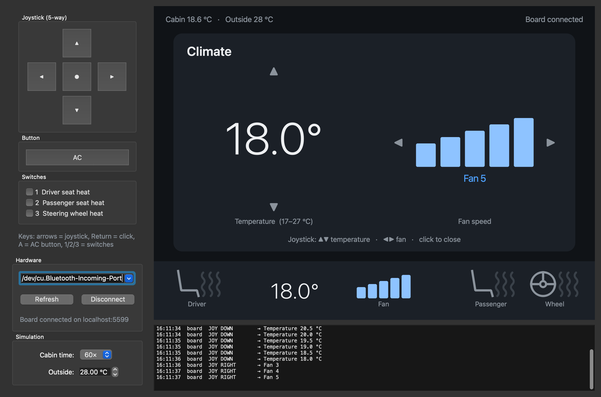

# CarControl

The goal of this project was a physical climate controller for my 2025 Volvo V60. The idea is a 5-way joystick, an AC button and three toggle switches wired to an Arduino UNO Q, which sends commands to the car over USB. The V60 puts almost all of its climate controls on the touchscreen, and reaching for a menu to bump the fan up a notch while driving gets old quickly.

The controller half of this works. The car half, as it turns out, can't be done over USB, so this repo pairs the real controller with a simulated car to develop and demo it on.



## Can it run in the real car?

Not over USB, at least not without going somewhere I don't want to go. The V60's infotainment runs Google built-in (Android Automotive), and as far as I can tell its USB ports only handle media, phone projection and charging. Nothing plugged into them can change the climate. The climate system lives on the car's internal CAN network. Injecting messages there is technically possible, but it means tapping wiring that also carries safety-critical traffic. It also risks the warranty, so I've ruled it out. Volvo's cloud API can start and stop preconditioning remotely, but as far as I know it can't set a temperature, a fan speed or the seat heaters, so it doesn't fit this either.

With this in mind, everything on the car side goes through one interface in [carcontrol/vehicle.py](carcontrol/vehicle.py). Right now `SimulatedVehicle` implements it. If a sanctioned way to command the car shows up, it only has to implement the same five methods, and the controller, firmware and protocol stay as they are.

## How the controls work

From simplest to most involved:

1. **Switches** work at any time, since they're physical on/off positions.
   1. Switch 1 turns the driver seat heater all the way on (level 3 of 3), and off when flipped back.
   2. Switch 2 does the same for the passenger seat.
   3. Switch 3 does the same for the steering wheel heater.
2. **The AC button** opens the climate menu, and pressing it again closes it.
3. **The joystick** only does anything while the climate menu is open, so bumping the stick can't change the climate by accident.
   1. Up and down raise and lower the temperature by 0.5 °C, between 17 and 27 °C.
   2. Left and right lower and raise the fan speed, from off up to 5.
   3. Clicking the joystick closes the menu.
   4. Holding a direction repeats it every 150ms after a 400ms pause, the same as a key held on a keyboard.

The logic lives in [carcontrol/controller.py](carcontrol/controller.py). It takes board events in and sends vehicle commands out, with nothing hardware-specific in between.

## Setup

It needs Python 3.10 or newer (I developed on 3.12):

```bash
git clone https://github.com/Lucalo44/CarControl.git
cd CarControl
python3 -m venv .venv
source .venv/bin/activate
pip install -r requirements.txt
```

The virtual environment has to be active in every new terminal (`source .venv/bin/activate`), or `python` won't find the packages.

## Running the simulator

```bash
python -m carcontrol
```

The left side of the window is a virtual controller with an on-screen joystick, the AC button and the three switches. The keyboard works too: the arrow keys are the joystick, Return clicks it, A is the AC button, and 1, 2 and 3 flip the switches. The right side is a stand-in for the car's centre screen. It has a climate bar along the bottom, the climate menu when it's open, and the cabin temperature. Cabin time runs 10× faster by default, so the cabin visibly cools toward the setpoint (switchable to 1× or 60×).


### Testing without a board

To test the hardware path without any hardware, [tools/fake_board.py](tools/fake_board.py) pretends to be the controller. It opens a virtual serial port and plays a scripted demo:

```bash
python tools/fake_board.py
# prints e.g. "Fake board on /dev/ttys011", then in a second terminal:
python -m carcontrol --serial /dev/ttys011
```

Add `--interactive` to type the inputs yourself (`ac`, `up`, `left`, `press`, `sw1 on` and so on). Add `--tcp 5555` to serve over the network the way the UNO Q does, then connect with `--tcp localhost:5555`. Of note, `python -m carcontrol --headless --serial PORT` skips the window and prints one line per event, which is handy for checking wiring.

## Building the controller

### Wiring

Every input goes between its pin and GND. The firmware turns on the internal pull-ups, so there are no resistors to add, and a closed contact reads LOW. That suits the UNO Q's 3.3V microcontroller fine. The pin map sits at the top of [carcontrol_inputs.h](firmware/carcontrol_serial/carcontrol_inputs.h):

1. Joystick up, down, left, right and click on D2 to D6. The common pin of the 5-way module goes to GND.
2. The AC button on D7.
3. Switches 1, 2 and 3 on D8, D9 and D10.

The firmware debounces each input for 20ms. It sends switch positions on every change, and all three again whenever the host connects, so the display never shows a heater off while its switch is on.

### Which firmware

Specifically, the UNO Q's USB-C port belongs to its Linux processor rather than the microcontroller the buttons are wired to. That's why there are two versions:

1. **[firmware/carcontrol_serial](firmware/carcontrol_serial/carcontrol_serial.ino)** is for boards whose USB port talks straight to the microcontroller (UNO R3/R4, Nano and the like). Flash it from the Arduino IDE, then run `python -m carcontrol` and pick the port, or pass `--serial /dev/cu.usbmodem…`.
2. **[firmware/unoq_app](firmware/unoq_app/)** is an Arduino App Lab app for the UNO Q. The [sketch](firmware/unoq_app/sketch/sketch.ino) reads the inputs and hands each event across the Bridge to [python/main.py](firmware/unoq_app/python/main.py) on the Linux side. That script serves the events on TCP port 5555, in the same line protocol. Connect with `--tcp <board-ip>:5555`. To keep it over the USB cable instead, forward the port with `adb forward tcp:5555 tcp:5555` and connect to `localhost:5555`.

I haven't flashed either one onto real hardware yet. Of the two, the UNO Q app is the bigger unknown, since I wrote its Bridge calls from Arduino's documentation without a board to check them against.

### The protocol

The board sends one event per line at 115200 baud: `HELLO CarControl 1`, `BTN AC`, `JOY UP`/`DOWN`/`LEFT`/`RIGHT`/`PRESS`, and `SW 1 ON`/`SW 1 OFF` (likewise 2 and 3). When the host sends `?`, the board replies with `HELLO` and its switch positions. Anything else is ignored, so the firmware can print debug text freely. The parser is in [carcontrol/protocol.py](carcontrol/protocol.py), and the serial and TCP readers are in [carcontrol/sources.py](carcontrol/sources.py).

## Tests

```bash
python -m pytest tests
```

The 29 tests in [tests/test_carcontrol.py](tests/test_carcontrol.py) cover several areas:

1. **Protocol:** the parser, plus serial reads that split lines at arbitrary points.
2. **Menu rules:** including the joystick doing nothing while the menu is closed.
3. **Limits:** temperature and fan stop at their ends.
4. **Heaters:** each switch turns its heater fully on and off.
5. **Cabin model:** a higher fan speed pulls the cabin to the target faster.
6. **Serial path:** a full run through pyserial's loopback port.
7. **Firmware:** a check that the two copies of the firmware's input code stay identical.
