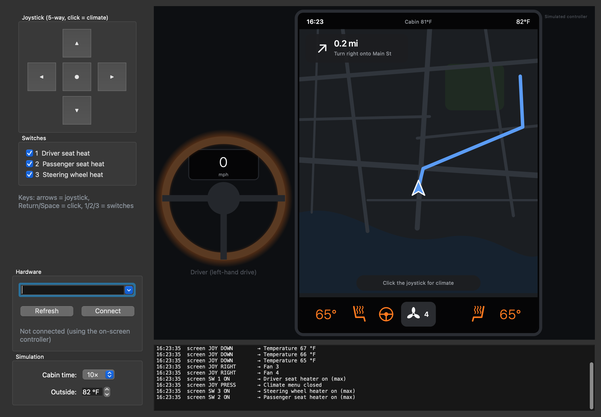

# CarControl

The goal of this project was a physical climate controller for my 2025 Volvo V60. The idea is a thumb joystick and three toggle switches wired to an Arduino UNO Q, which sends commands to the car over USB. The V60 puts almost all of its climate controls on the touchscreen, and reaching for a menu to bump the fan up a notch while driving gets old quickly.

The controller half of this works. The car half, as it turns out, can't be done over USB, so this repo pairs the real controller with a simulated car to develop and demo it on.


## Can it run in the real car?

Not over USB, at least not without going somewhere I don't want to go. The V60's infotainment runs Google built-in (Android Automotive), and as far as I can tell its USB ports only handle media, phone projection and charging. Nothing plugged into them can change the climate. The climate system lives on the car's internal CAN network. Injecting messages there is technically possible, but it means tapping wiring that also carries safety-critical traffic. It also risks the warranty, so I've ruled it out. Volvo's cloud API can start and stop preconditioning remotely, but as far as I know it can't set a temperature, a fan speed or the seat heaters, so it doesn't fit this either. CarPlay and Android Auto don't help, since both only project phone apps onto the screen and have no access to the car's climate.

With this in mind, everything on the car side goes through one interface in [carcontrol/vehicle.py](carcontrol/vehicle.py). Right now `SimulatedVehicle` implements it. If a sanctioned way to command the car shows up, it only has to implement the same five methods, and the controller, firmware and protocol stay as they are.

## How the controls work

From simplest to most involved:

1. **Switches** work at any time, since they're physical on/off positions.
   1. Switch 1 turns the driver seat heater all the way on (level 3 of 3), and off when flipped back.
   2. Switch 2 does the same for the passenger seat.
   3. Switch 3 does the same for the steering wheel heater.
2. **Clicking the joystick** opens the climate menu, and clicking it again closes it. I originally had a separate AC button for this, but the joystick's own click already does the job, and dropping the button means one less hole to drill and one less pin to wire.
3. **Pushing the joystick** only does anything while the climate menu is open, so bumping the stick can't change the climate by accident. Opening the menu takes a deliberate click.
   1. Up and down raise and lower the temperature by 1 °F, between 62 and 82 °F (the same range and step as a US-market Volvo).
   2. Left and right lower and raise the fan speed, from off up to 5.
   3. Holding a direction repeats it every 150ms after a 400ms pause, the same as a key held on a keyboard.

The logic lives in [carcontrol/controller.py](carcontrol/controller.py). It takes board events in and sends vehicle commands out, with nothing hardware-specific in between.

## Setup

It needs Python 3.10 or newer (I developed on 3.12):

```bash
git clone https://github.com/Lucalo44/CarControl.git
cd CarControl
python3 -m venv .venv
source .venv/bin/activate
pip install -r requirements.txt
```

The virtual environment has to be active in every new terminal (`source .venv/bin/activate`), or `python` won't find the packages.

## Running the simulator

```bash
python -m carcontrol
```

The left side of the window is a virtual controller with an on-screen joystick and the three switches. The keyboard works too: the arrow keys are the joystick, Return or Space clicks it, and 1, 2 and 3 flip the switches.

The right side is modelled on the dashboard of a left-hand-drive Volvo running [Volvo Car UX](https://www.volvocars.com/us/cars/volvo-car-ux/), the Google built-in interface on my V60. In order to test the controller against something close to what I'd actually be looking at, the centre display is drawn at the V60's 9-inch portrait proportions. A map fills the home screen, with a fixed climate bar along the bottom. That bar is laid out for left-hand drive, so the driver's temperature, seat and steering wheel heater sit on the left, the fan in the middle, and the passenger's seat and temperature on the right. Clicking the joystick slides a climate sheet up over the map, with the temperature, a segmented fan slider and a tile for each heater (again driver first). The temperature shows on both zones because the controller sets a single setpoint, which matches Volvo's synced mode. The steering wheel and driver display sit to the left of the screen, and the rim glows when its heater is on. Of note, this is a lookalike drawn in Qt rather than Volvo's actual software, so the colours and layout are my best approximation. Every temperature is in Fahrenheit, as it is on a US car. Cabin time runs 10× faster by default, so the cabin visibly cools toward the setpoint (switchable to 1× or 60×).



### Testing without a board

To test the hardware path without any hardware, [tools/fake_board.py](tools/fake_board.py) pretends to be the controller. It opens a virtual serial port and plays a scripted demo:

```bash
python tools/fake_board.py
# prints e.g. "Fake board on /dev/ttys011", then in a second terminal:
python -m carcontrol --serial /dev/ttys011
```

Add `--interactive` to type the inputs yourself (`press`, `up`, `left`, `sw1 on` and so on). Add `--tcp 5555` to serve over the network the way the UNO Q does, then connect with `--tcp localhost:5555`. Of note, `python -m carcontrol --headless --serial PORT` skips the window and prints one line per event, which is handy for checking wiring.

## Building the controller

### Wiring

I first wrote the firmware for a 5-way switch module, then found that the joystick I actually have is an analog thumb stick (GND, +5V, VRx, VRy and SW pins). Each axis is a potentiometer, so the firmware reads VRx and VRy on analog pins and counts a push past 50% of the travel as a press of that direction. It only lets go once the stick is back inside 30%, which stops it flickering on the edge. Of note, only the axis pushed furthest counts, so a sloppy diagonal can't change the temperature and the fan at once. The pin map sits at the top of [carcontrol_inputs.h](firmware/carcontrol_serial/carcontrol_inputs.h):

1. Joystick GND to GND, and +5V to **3.3V**. The UNO Q's microcontroller runs at 3.3V, and feeding the stick 5V would put up to 5V on its analog pins. On a 5V board like the UNO R4, 5V is fine.
2. VRx to A0, VRy to A1, and SW to D2. SW closes to GND on a click, and the firmware turns on the pin's internal pull-up, so it needs no resistor.
3. Switches 1, 2 and 3 between D3, D4 and D5 and GND, again on internal pull-ups.

The firmware measures where the stick rests when the board starts, so it should be left centred during boot. Which way a stick reads depends on how it's mounted. If up comes out as down, or the axes are swapped, there are three flags (`JOY_INVERT_X`, `JOY_INVERT_Y`, `JOY_SWAP_XY`) next to the pin map. My stick came out with up and down reversed on the first try, so `JOY_INVERT_Y` is set to true. Left and right were correct out of the box. The firmware debounces each input for 20ms. It sends switch positions on every change, and all three again whenever the host connects, so the display never shows a heater off while its switch is on.

### Which firmware

Specifically, the UNO Q's USB-C port belongs to its Linux processor rather than the microcontroller the buttons are wired to. That's why there are two versions:

1. **[firmware/carcontrol_serial](firmware/carcontrol_serial/carcontrol_serial.ino)** is for boards whose USB port talks straight to the microcontroller (UNO R3/R4, Nano and the like). Flash it from the Arduino IDE, then run `python -m carcontrol` and pick the port, or pass `--serial /dev/cu.usbmodem…`.
2. **[firmware/unoq_app](firmware/unoq_app/)** is an Arduino App Lab app for the UNO Q, and it's the one I actually run. The [sketch](firmware/unoq_app/sketch/sketch.ino) reads the inputs and hands each event across the Bridge to [python/main.py](firmware/unoq_app/python/main.py) on the Linux side. That script serves the events on TCP port 5555, in the same line protocol.

### Running it on the UNO Q

The UNO Q shows up over USB-C as an adb device, and its Linux side has `arduino-app-cli`, so the app can be deployed straight from a terminal without opening App Lab:

```bash
adb shell mkdir -p /home/arduino/ArduinoApps/carcontrol
adb push firmware/unoq_app/app.yaml firmware/unoq_app/sketch firmware/unoq_app/python /home/arduino/ArduinoApps/carcontrol/
adb shell arduino-app-cli app start user:carcontrol    # compiles and flashes the sketch, then starts the Python side
adb forward tcp:5555 tcp:5555
python -m carcontrol --tcp localhost:5555
```

The first start takes a few minutes, since it compiles the sketch and builds the Python container. Over Wi-Fi, skip the forward and connect to `--tcp <board-ip>:5555` instead. Before opening the window, `python -m carcontrol --headless --tcp localhost:5555` prints one line per input, which is the quickest way to check each wire and the stick's directions.

The first real run went better than I expected. The Bridge calls, which I'd written from Arduino's documentation without a board to check them against, worked the first time. A few things did trip me up:

1. App Lab apps need a `sketch.yaml` and the port listed in `app.yaml`. Neither was in my first version, and both are in the repo now.
2. Only one app runs at a time. The board refused to start CarControl while my earlier test app was running, so that one has to be stopped first (`arduino-app-cli app stop user:<name>`).
3. The app doesn't start by itself after the board resets, so `app start` has to be run again.
4. The board reset twice while I was handling the wiring. Each time its log simply stopped, with no shutdown, which points to a short between 3.3V and GND rather than a software crash. I now unplug the board before moving any jumpers.

### The protocol

The board sends one event per line at 115200 baud: `HELLO CarControl 1`, `JOY UP`/`DOWN`/`LEFT`/`RIGHT`/`PRESS`, and `SW 1 ON`/`SW 1 OFF` (likewise 2 and 3). When the host sends `?`, the board replies with `HELLO` and its switch positions. Anything else is ignored, so the firmware can print debug text freely. The parser is in [carcontrol/protocol.py](carcontrol/protocol.py), and the serial and TCP readers are in [carcontrol/sources.py](carcontrol/sources.py).

## Tests

```bash
python -m pytest tests
```

The 28 tests in [tests/test_carcontrol.py](tests/test_carcontrol.py) cover several areas:

1. **Protocol:** the parser, plus serial reads that split lines at arbitrary points.
2. **Menu rules:** the click toggling the menu, and the joystick doing nothing while the menu is closed.
3. **Limits:** temperature and fan stop at their ends.
4. **Heaters:** each switch turns its heater fully on and off.
5. **Cabin model:** a higher fan speed pulls the cabin to the target faster.
6. **Serial path:** a full run through pyserial's loopback port.
7. **Firmware:** a check that the two copies of the firmware's input code stay identical.
